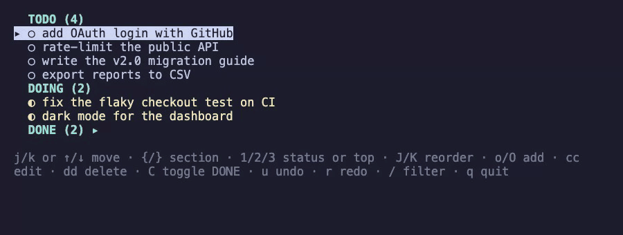

# todo tui app

An interactive task board in the terminal, stored as a Markdown file.
Vim-style keys, three sections - **TODO**, **DOING**, **DONE**.



## Install

Needs Go 1.27.2+ and `make`.

### With sudo

```
make build
sudo make install    # /usr/local/bin/todo
```

### Without sudo

Use any directory you own that is on your `PATH`.

```
make build
PREFIX=~/.local/bin make install
```

## Usage

```
todo              # ./todo-database.md, created if missing
todo board.md     # any other board file
todo --help       # the key bindings
```

`todo` opens the board in whatever directory you run it from, so each project keeps its own.

A file the parser cannot read whole is refused at startup rather than silently rewritten.

## Development

```
make run     # a throwaway copy of the example board
make test
```

## Uninstall

This removes the binary only. Your board files stay where they are.

### With sudo

```
sudo make uninstall    # /usr/local/bin/todo
```

### Without sudo

Use the same `PREFIX` you installed with.

```
PREFIX=~/.local/bin make uninstall
```

## Docs

- [overview.md](docs/overview.md) - the design and the file format
- [security-review.md](docs/security-review.md) - the threat model, the findings and the dependency audit

## License

[MIT](LICENSE) - use it, change it, ship it, sell it. Just keep the copyright notice.
